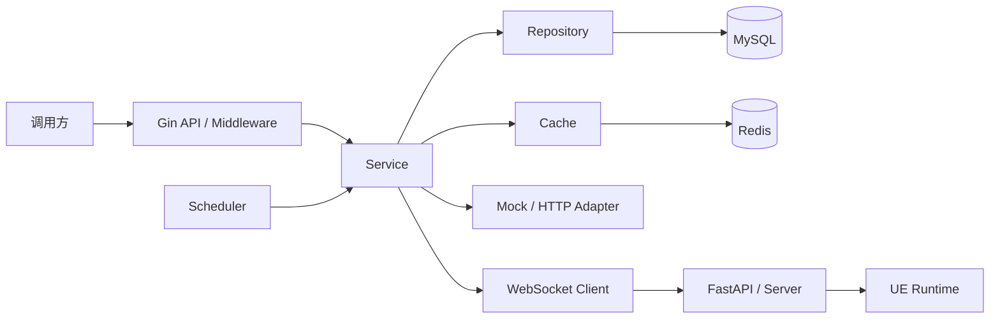

# 架构概览

dcx-gateway 为 UE 展示系统提供配置存储、业务数据组装、缓存和实时数据推送。HTTP 入口使用 Gin，持久化使用 GORM/MySQL，热数据与 Session 使用 Redis；FastAPI/Server 负责后续 UE 控制和消息分发。

## 分层与组件

| 层 | 主要位置 | 职责 |
|---|---|---|
| 应用入口 | `cmd/dcx-gateway/main.go` | 读取运行配置，启动和关闭应用 |
| 装配与生命周期 | `internal/bootstrap/app.go` | 初始化依赖、注册路由、管理 HTTP 与后台任务 |
| API | `internal/api/router.go`、`internal/api/handler` | 接收 HTTP 请求、校验输入、转换错误与输出响应 |
| 业务服务 | `internal/service` | 配置规则、数据组装、预热与业务动作编排 |
| 持久化 | `internal/repository` | MySQL 查询、事务、锁和原子写入 |
| 缓存 | `internal/cache` | 业务快照、图表运行时数据、视频状态与登录 Session |
| 外部适配 | `internal/adapter` | 将 Mock 或 HTTP 上游数据转换为内部领域对象 |
| 协议与模型 | `internal/model` | 数据库实体、DTO、领域对象和 Gateway/UE 协议 |
| 实时与任务 | `internal/websocket`、`internal/scheduler` | FastAPI WebSocket 连接与定时预热 |

## 配置与业务数据链路

配置请求通常由 Handler 调用 Service，再通过 Repository 操作 MySQL。业务层负责参数规则、模型视图生成、锚点 revision 校验和批量替换语义；需要原子修改的操作在 Repository 事务内完成。

脚本数据请求根据脚本、模块和绑定配置组装 DataBundle。Service 优先使用缓存，必要时通过 Adapter 获取业务数据，再由 Mapper 转换为协议对象。预热和运行时图表缓存也复用这条业务链路。

WebSocket 客户端向 FastAPI `/ws_data` 推送事件，并负责鉴权头、心跳、断线后的重连及连接状态。网关不直接向 UE 下发控制命令；具体事件与字段参见[数据流转契约](data-flow.md)和[接口文档](../api/ue-config.md)。

## 数据职责

| 数据类型 | 存储位置 | 说明 |
|---|---|---|
| 配置、脚本、模型、锚点和设备/Agent 记录 | MySQL | 作为持久化配置和记录来源 |
| DataBundle、模块数据与运行时图表值 | Redis | 热数据与预热结果，带缓存过期策略 |
| 用户信息与密码 hash | MySQL | 公开种子不创建默认登录用户 |
| 登录 Session | Redis | 服务端 Session，不在接口返回密码 hash |
| 外部业务源 | Mock 或独立 HTTP 系统 | 通过 Adapter 隔离上游协议 |

## 启动与运行

入口默认读取 `configs/config.dev.yaml`。应用创建 MySQL、Redis、Repository、Cache、Adapter、Service 和 Handler，随后注册路由。`Run` 启动 HTTP 服务及已配置的后台任务；收到退出信号后停止任务并关闭连接。

公开版本仅提供配置模板和虚构种子，首次运行需要自行准备 MySQL/Redis 并执行编号 migration。FastAPI WebSocket 默认不启用。详细步骤见[项目 README](../../readme.md)与[部署说明](../operations/deployment.md)。

## 文档边界

当前操作指南与[历史设计归档](../archive/README.md)分开维护。归档中的阶段方案用于解释设计背景；接口、表结构和默认行为以当前源码、编号 migration 与 OpenAPI 为准。
