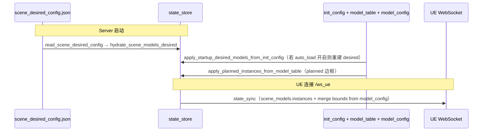
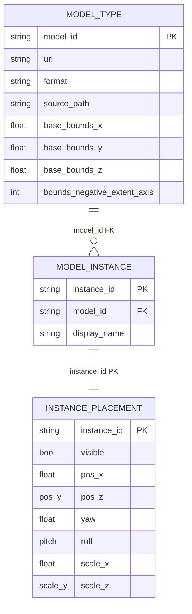

# 模型配置归一化设计建议（model_id / instance_id 分层）

> 状态：历史归档。本文保留阶段性分析或设计提案，不代表当前功能与数据库现状。当前用法请以[文档首页](../README.md)、[接口说明](../api/ue-config.md)及源码为准。

> **目的**：降低单独以 `scene_desired_config.json` 为基准做 Gateway 数据库表与 REST 接口的设计复杂度；并说明如何将 **全部** `config/*.json` 迁入 Gateway 数据库，在 **Server / UE 重启** 时仍能恢复场景，且 **不影响** Web / UE 协议与其他配置模块。  
> **范围**：设计文档与迁移建议；**不修改**当前 NDisplay Server / UE / Web 工程代码。  
> **关联文件**：`config/*.json`（尤其 `scene_desired_config.json`、`model_config.json`、`model_table.json`）  
> **关联文档**：[当前 UE 配置接口](../api/ue-config.md)、`NDisplay-Server-Integration.md`（上游历史资料，未随本仓库分发）

**文档结构**

| 章节 | 内容 |
|------|------|
| §1–§8 | `model_id` / `instance_id` 归一化、建表、API、合成算法 |
| §9、§14 | 数据迁移步骤、全量 `config/*.json` → Gateway 映射 |
| §15–§20 | **同步拉取**、写路径分流、重启/重连时序、零停机迁移 |
| §10–§13 | 角标、风险、实施顺序、小结 |

---

## 1. 现状与问题

### 1.1 三份配置各自承担什么

| 文件 | 结构 | 当前职责 | 数据粒度 |
|------|------|----------|----------|
| `model_table.json` | `entries[]` | 实例目录：`instance_id` ↔ `model_id` + `display_name` | **实例**（轻量） |
| `model_config.json` | `last_load_by_instance_id{}` | 上次加载快照：`model_id`、`visible`、`transform`、`bounds_size` | **实例**（运行时） |
| `scene_desired_config.json` | `scene_models_desired[]` | 场景期望态全量：资产 URI、格式、静态元数据 + 变换 + 显隐 | **实例**（扁平全量） |

### 1.2 扁平化带来的复杂度

以当前 36 个实例、4 种 `model_id` 为例，`scene_desired_config.json` 每条记录重复写入：

- **模型类型级**（应只存 1 份）：`uri`、`format`、`source_path`、基础 `bounds_size`
- **实例级**（应各存 1 份）：`instance_id`、`display_name`、`visible`、`transform`

典型重复（同一 `model_id` 的 9 个实例各写一遍）：

```json
{
  "model_id": "discussion_room",
  "uri": "file://./models/Datasmith/discussion room/discussion room.udatasmith",
  "format": "udatasmith",
  "source_path": "./models/Datasmith/discussion room/discussion room.udatasmith",
  "bounds_size": { "x": 1420.99, "y": 983.02, "z": 430.09 }
}
```

若以此扁平结构直接建 Gateway 表，会导致：

1. **表宽过大**：单表混合静态资产与动态位姿，CRUD 边界不清。
2. **一致性难保证**：改 `discussion_room` 的 URI 需 PATCH 9 行；`bounds_size` 各实例浮点微差（如 `430.09285600000294` vs `430.092856000003`）无业务意义。
3. **与已有配置分裂**：`model_table` / `model_config` 已在 Gateway 可读，但 `scene_desired` 仍走 Server 本地 IO，三套数据源语义重叠。
4. **接口设计困难**：无法区分「改模型资产」与「改实例位姿」，partial update 字段集过大。

### 1.3 运行时对 `bounds_size` 的隐含约定

UE 侧包围盒解析（`DcRuntimeModelBoundsService`）逻辑为：

```
local_size = bounds_size / abs(scale)
world_corners = transform(local AABB built from local_size)
```

即协议里下发的 `bounds_size` 被当作 **世界空间尺寸（已含 scale 效果）**；引擎内部再除以 `scale` 还原局部盒。

当前 JSON 中 `test_model_*` 的 `scale = 0.1` 但 `bounds_size` 仍为 `{770, 1130, 600}`（与 scale=1 时相同），说明磁盘上实际存的是 **模型原生尺寸（scale=1 基准）**，与 UE 除法语义不完全一致，靠「scale 为 1 的实例」掩盖了差异。

**归一化目标**：在数据库中显式区分 `base_bounds_size`（`model_id` 级）与 `world_bounds_size`（由实例 `scale` 导出），消除歧义。

### 1.4 `scene_desired_config.json` 在重启恢复中的真实职责

该文件 **不是** 静态预设配置，而是 **场景期望态（desired state）的运行时快照**，用于在 **NDisplay Server 进程重启** 或 **UE 会话重连** 后恢复「上次应加载的模型列表及其位姿/显隐」。

当前恢复链路（`server/application/lifespan.py` + `ws/handlers.py`）：



| 阶段 | 数据来源 | 作用 |
|------|----------|------|
| Server 启动 hydrate | `scene_desired_config.json` | 把磁盘快照灌入 `state_store.scene_models_desired` |
| 启动白名单（可选） | `init_config` ∩ `model_table` ∩ `model_config` | `auto_load_on_startup=true` 时 **清空并重建** desired |
| UE 重连 | `state_store` 内存 | `should_sync_to_ue_on_connect()` → 下发 `state_sync` |
| 运行时变更 | Web `model_load` / `model_set` 等 | `upsert_scene_model_desired` → **写回** `scene_desired_config.json` |

**迁入 Gateway 后不变的是行为，变的是持久化位置**：Gateway DB 中的「模型类型 + 实例目录 + 位姿」合成出与今日扁平 JSON **等价的** `scene_models_desired[]`，Server 启动时 **拉取合成结果** 而非读本地文件；UE 收到的 `state_sync` 载荷形状 **保持不变**。

---

## 2. 设计原则

1. **模型类型（`model_id`）管资产与几何基准** — URI、格式、源路径、基础包围盒、负向延伸轴等。
2. **模型实例（`instance_id`）管场景语义** — 绑定哪个 `model_id`、显示名、显隐、位姿（position / rotation / scale）。
3. **合成视图按需生成** — 等价于今日 `scene_desired_config.json` 的扁平记录，由 Gateway **读时 JOIN / 生成**，不作为权威存储形态。
4. **对齐 init_config V0.0.2** — 实例增删用 Create/Delete；静态字段 PUT partial；避免「一条 PUT 替换 900 行 JSON」。
5. **兼容现有 Server** — 过渡期 Gateway 同时提供 `mode=legacy` 扁平 JSON，便于 `scene_desired.py` 无改动对接。
6. **读穿、写分流** — 所有 `read_*` 统一走 Gateway Read-Through；运行时 desired 变更只写 **mutable** 层（placement），不写重复静态字段。
7. **隔离与回退** — `DATA_GATEWAY_URL` 为空时行为与今日离线模式完全一致；Gateway 不可达时可选读本地 shadow 缓存，**不改变** Web/UE 协议。

---

## 3. 逻辑分层与文件映射



| 逻辑实体 | 权威来源（建议） | 对应现有 JSON |
|----------|------------------|---------------|
| `MODEL_TYPE` | Gateway 新表 / 新 config 文档 | 从 `scene_desired` **去重** `model_id` 提取 |
| `MODEL_INSTANCE` | 扩展 `model_table` | `model_table.json` → `entries` |
| `INSTANCE_PLACEMENT` | 扩展 `model_config` 或新 `scene_instance` 表 | `model_config.last_load_by_instance_id` 中的 `visible` + `transform` |

**不再**在实例行持久化：`uri`、`format`、`source_path`、`bounds_size`（改为 JOIN + 计算）。

---

## 4. 数据库表设计（MySQL）

### 4.1 `ue_model_types` — 模型类型（`model_id`）

```sql
CREATE TABLE ue_model_types (
    model_id          VARCHAR(64)  PRIMARY KEY,
    uri               VARCHAR(512) NOT NULL,
    format            VARCHAR(32)  NOT NULL DEFAULT 'udatasmith',
    source_path       VARCHAR(512) NOT NULL,
    base_bounds_x     DOUBLE       NOT NULL,
    base_bounds_y     DOUBLE       NOT NULL,
    base_bounds_z     DOUBLE       NOT NULL,
    bounds_negative_extent_axis INT NULL COMMENT '-1=全正向; 0=X; 1=Y; 2=Z',
    enabled           TINYINT(1)   NOT NULL DEFAULT 1,
    updated_at        TIMESTAMP    NOT NULL DEFAULT CURRENT_TIMESTAMP ON UPDATE CURRENT_TIMESTAMP
);
```

**种子数据（当前仓库 4 种 model_id）：**

| model_id | base_bounds (x,y,z) cm |
|----------|-------------------------|
| `discussion_room` | 1420.998, 983.022, 430.093 |
| `lecture_hall` | 1729.995, 1293.883, 1038.219 |
| `vip_reception_room` | 900, 1250, 530 |
| `test_model` | 770, 1130, 600 |

> 取值：对同 `model_id` 各实例在 `scene_desired_config.json` 中的 `bounds_size` 取 **中位数或首个 scale=(1,1,1) 实例**，作为 canonical 基准。

### 4.2 `ue_model_instances` — 实例目录（`instance_id`）

在现有 `model_table` 语义上扩展（或独立表 + 视图合成 `model-table` JSON）：

```sql
CREATE TABLE ue_model_instances (
    instance_id   VARCHAR(64)  PRIMARY KEY,
    model_id      VARCHAR(64)  NOT NULL,
    display_name  VARCHAR(128) NOT NULL DEFAULT '',
    sort_order    INT          NULL,
    enabled       TINYINT(1)   NOT NULL DEFAULT 1,
    created_at    TIMESTAMP    NOT NULL DEFAULT CURRENT_TIMESTAMP,
    updated_at    TIMESTAMP    NOT NULL DEFAULT CURRENT_TIMESTAMP ON UPDATE CURRENT_TIMESTAMP,
    CONSTRAINT fk_instance_model
        FOREIGN KEY (model_id) REFERENCES ue_model_types(model_id)
        ON UPDATE CASCADE ON DELETE RESTRICT
);

CREATE INDEX idx_model_instances_model_id ON ue_model_instances(model_id);
```

与 `init_config.instance_ids` 关系：**实例白名单**仍由 `init_config` 管理；`ue_model_instances` 是全量注册表，启动加载取二者交集（与现逻辑一致）。

### 4.3 `ue_model_instance_placement` — 实例位姿与显隐

```sql
CREATE TABLE ue_model_instance_placement (
    instance_id   VARCHAR(64)  PRIMARY KEY,
    visible       TINYINT(1)   NOT NULL DEFAULT 1,
    pos_x         DOUBLE       NOT NULL DEFAULT 0,
    pos_y         DOUBLE       NOT NULL DEFAULT 0,
    pos_z         DOUBLE       NOT NULL DEFAULT 0,
    yaw           DOUBLE       NOT NULL DEFAULT 0,
    pitch         DOUBLE       NOT NULL DEFAULT 0,
    roll          DOUBLE       NOT NULL DEFAULT 0,
    scale_x       DOUBLE       NOT NULL DEFAULT 1,
    scale_y       DOUBLE       NOT NULL DEFAULT 1,
    scale_z       DOUBLE       NOT NULL DEFAULT 1,
    updated_at    TIMESTAMP    NOT NULL DEFAULT CURRENT_TIMESTAMP ON UPDATE CURRENT_TIMESTAMP,
    CONSTRAINT fk_placement_instance
        FOREIGN KEY (instance_id) REFERENCES ue_model_instances(instance_id)
        ON UPDATE CASCADE ON DELETE CASCADE
);
```

**不在此表存储 `bounds_size`** — 见 §5 计算公式。

### 4.4 可选：`ue_scene_desired_snapshot`（兼容层）

若需保留「单文档 GET」习惯，可存 **生成态** JSON（非权威）：

```sql
CREATE TABLE ue_config_documents (
    config_key     VARCHAR(64) PRIMARY KEY,
    content_json   JSON        NOT NULL,
    version        INT         NOT NULL DEFAULT 1,
    updated_at     TIMESTAMP   NOT NULL DEFAULT CURRENT_TIMESTAMP ON UPDATE CURRENT_TIMESTAMP
);
```

`config_key = 'scene_desired'` 的 `content_json` 由触发器或应用层在 `model_types / instances / placement` 变更后 **重建**，等价于今日 `scene_desired_config.json`。

---

## 5. `bounds_size` 语义与计算公式

### 5.1 字段定义

| 字段 | 层级 | 含义 | 单位 |
|------|------|------|------|
| `base_bounds_size` | `model_id` | 模型资产在 **scale=1** 下的轴对齐包围盒尺寸（UE 局部空间） | cm |
| `scale` | `instance_id` | 实例 Transform 缩放 | 无量纲 |
| `world_bounds_size` | **导出** | 下发 UE / Web 预览用的世界空间包围盒尺寸 | cm |

### 5.2 计算规则（分量独立，与 UE Transform 一致）

```
world_bounds_size.x = base_bounds_size.x * abs(scale.x)
world_bounds_size.y = base_bounds_size.y * abs(scale.y)
world_bounds_size.z = base_bounds_size.z * abs(scale.z)
```

**示例：`test_model_1`**

- `base_bounds_size` = `{770, 1130, 600}`（来自 `ue_model_types`）
- `scale` = `{0.1, 0.1, 0.1}`（来自 `ue_model_instance_placement`）
- **导出** `bounds_size` = `{77, 113, 60}`

**示例：`discussion_room_1`**

- `base_bounds_size` = `{1420.998, 983.022, 430.093}`
- `scale` = `{1, 1, 1}`
- **导出** `bounds_size` = 与 base 相同

### 5.3 与 UE 运行时对齐

UE 现有逻辑 `local_size = bounds_size / abs(scale)` 要求协议中的 `bounds_size` 为 **world_bounds_size**。归一化后：

- **Gateway / Server 合成扁平记录时**写入 `world_bounds_size`；
- **DB 只存** `base_bounds_size`，避免 scale 变更时需同步改两处。

### 5.4 `bounds_negative_extent_axis`

保留在 `ue_model_types` 上（模型级几何约定，非实例级）。合成 flat record 时透传至 `bounds_negative_extent_axis` 字段（与 `model_config.py` 现有 merge 行为一致）。

---

## 6. Gateway API 设计建议

参考 [当前 init_config 接口](../api/ue-config.md#init_config)，将模型配置拆为 **三类读路径 + 分层写路径**。

### 6.1 读取

| 方法 | 路径 | 说明 |
|------|------|------|
| GET | `/ue/config/model-table` | **保持兼容**：返回 `{ version, entries[] }`，同今日 `model_table.json` |
| GET | `/ue/config/model-types` | **新增**：返回 `{ version, model_types[] }`，每项含 `model_id` + 资产 + `base_bounds_size` |
| GET | `/ue/config/model-config?mode=structured` | **新增**：`{ version, placements: { [instance_id]: { visible, transform } } }`，不含 bounds |
| GET | `/ue/config/model-config?mode=runtime` | **新增**：JOIN 后按实例输出 **含** `world_bounds_size` 的完整 load 配置（等价 `last_load_by_instance_id` + 正确 bounds） |
| GET | `/ue/config/scene-desired?mode=generated` | **新增**：JOIN 生成扁平 `scene_models_desired[]`（替代本地 `scene_desired_config.json`） |
| GET | `/ue/config/scene-desired?mode=legacy` | 读 `ue_config_documents` 快照（迁移期） |

### 6.2 写入（建议 V0.0.3）

#### A. 模型类型 `model_id`

| CRUD | 方法 | 路径 | Body 要点 |
|------|------|------|-----------|
| Read | GET | `/ue/config/model-types` | — |
| Create | POST | `/ue/config/model-types/create` | `model_id`, `uri`, `format`, `source_path`, `base_bounds_size` |
| Update | PUT | `/ue/config/model-types` | partial：`{ "model_id": "...", "uri": "..." }` 或数组 batch |
| Delete | DELETE | `/ue/config/model-types/delete` | `{ "model_id": "..." }`；若仍有实例引用则 409 |

#### B. 实例目录 `instance_id` ↔ `model_id`

| CRUD | 方法 | 路径 | 说明 |
|------|------|------|------|
| Read | GET | `/ue/config/model-table` | 不变 |
| Create | POST | `/ue/config/model-table/entries/create` | `{ instance_id, model_id, display_name? }` |
| Update | PUT | `/ue/config/model-table/entries` | partial：`display_name` / 改绑 `model_id` |
| Delete | DELETE | `/ue/config/model-table/entries/delete` | `{ instance_id }`；级联删 placement |

> 与 `init_config.instance_ids`：**Create 实例时不自动加入启动白名单**；需另调 `POST .../init-config/instance_ids/create`（职责分离）。

#### C. 实例位姿 `placement`

| CRUD | 方法 | 路径 | Body 要点 |
|------|------|------|-----------|
| Read | GET | `/ue/config/model-config?mode=structured` | — |
| Update | PUT | `/ue/config/model-config/placements` | partial per instance：`visible`, `transform.position`, `transform.scale` 等 |
| Update | PUT | `/ue/config/model-config/placements/{instance_id}` | 单实例 patch |

**禁止**在 placement PUT 中接受 `bounds_size`（Server/Gateway 忽略并打 warn），与现有 `merge_static_metadata_from_model_config` 哲学一致：**bounds 权威在 model_id**。

#### D. 扁平 scene desired（可选快捷口）

| 方法 | 路径 | 说明 |
|------|------|------|
| PUT | `/ue/config/scene-desired` | 仅接受 **mutable** 字段批量更新（`visible`, `transform`）；静态字段忽略 |
| GET | `/ue/config/scene-desired?mode=generated` | Server UE 重连时拉取 |

### 6.3 Web → NDisplay Server 映射（未来）

| Web（Server :8000） | Gateway |
|---------------------|---------|
| `GET /api/config/model-table` | `GET .../model-table` |
| `GET /api/config/model` | `GET .../model-config?mode=runtime` |
| `PUT /api/config/model-table` | `POST/PUT/DELETE .../model-table/entries/*` |
| `PUT /api/config/model` | `PUT .../model-config/placements` |
| （新增）`GET /api/config/model-types` | `GET .../model-types` |

---

## 7. 合成算法：生成扁平 `scene_models_desired` 记录

伪代码（Gateway 或 Server 读路径均可实现）：

```
function build_scene_desired_record(instance_id):
    inst  = model_instances[instance_id]
    type  = model_types[inst.model_id]
    place = placements[instance_id] or defaults

    scale = place.transform.scale or {1,1,1}
    world_bounds = {
        x: type.base_bounds_x * abs(scale.x),
        y: type.base_bounds_y * abs(scale.y),
        z: type.base_bounds_z * abs(scale.z),
    }

    return {
        instance_id: instance_id,
        model_id: inst.model_id,
        uri: type.uri,
        format: type.format,
        source_path: type.source_path,
        display_name: inst.display_name,
        bounds_size: world_bounds,
        bounds_negative_extent_axis: type.bounds_negative_extent_axis,  // optional
        visible: place.visible,
        transform: place.transform,
    }
```

输出数组顺序建议：`model_table.entries` 顺序，或 `sort_order` 升序。

---

## 8. 与现有 JSON 的字段对照

### 8.1 从 `scene_desired_config.json` 拆出

| 原字段 | 归一化去向 | 备注 |
|--------|------------|------|
| `instance_id` | `ue_model_instances` | PK |
| `model_id` | `ue_model_instances` + JOIN | FK |
| `display_name` | `ue_model_instances` | 已在 `model_table` |
| `uri`, `format`, `source_path` | `ue_model_types` | 按 `model_id` 去重 |
| `bounds_size` | `ue_model_types.base_bounds_*` + 导出计算 | 不再 per-instance 存储 |
| `visible`, `transform` | `ue_model_instance_placement` | 与 `model_config` 对齐 |

### 8.2 `model_config.json` 迁移

今日结构：

```json
{
  "last_load_by_instance_id": {
    "discussion_room_1": {
      "model_id": "discussion_room",
      "visible": true,
      "transform": { ... },
      "bounds_size": { ... }
    }
  }
}
```

迁移后：

- `model_id`、`bounds_size` → **删除**（改 JOIN）
- `visible`、`transform` → `ue_model_instance_placement`
- `GET .../model-config?mode=runtime` 动态拼回，兼容 UE/Server 现有 consumer

### 8.3 `model_table.json`

结构不变；Gateway 表 `ue_model_instances` 为权威，`GET /model-table` 继续输出 `{ version, entries }`。

---

## 9. 数据迁移步骤（一次性脚本，非工程改动）

1. **提取 model types**：扫描 `scene_desired_config.json`，按 `model_id` group，取 canonical `uri/format/source_path/base_bounds_size`。
2. **导入 instances**：写入 `ue_model_instances`，来源 `model_table.json`（36 条）。
3. **导入 placements**：来源 `model_config.json` 或 `scene_desired` 的 `visible` + `transform`（二者应一致，冲突以 **scene_desired** 为准并打 log）。
4. **导入其余 preset**：见 §14 全量映射表，写入 `ue_config_documents` 或结构化表。
5. **校验**：对每个 `instance_id` 运行 §7 合成，与现 `scene_desired_config.json` diff；`bounds_size` 允许旧数据在 `scale≠1` 时不一致（以新公式为准）。
6. **切换读路径**：各 `read_*` 已走 Gateway 的保持不变；`read_scene_desired_config` 改为 `GET scene-desired?mode=generated`（属后续工程任务，本文档不实施）。
7. **deprecate 本地写**：Gateway 模式下 `write_scene_desired_config_from_records` 改为写 placement；本地 JSON 仅离线或 shadow 缓存。

---

## 14. 全量 `config/*.json` → Gateway 映射

将仓库 `config/` 下 **11 个 JSON** 全部纳入 Gateway，按 **存储形态** 分三类，避免「一律塞 `content_json`」导致 scene 模型类配置继续扁平膨胀。

### 14.1 总表

| 本地文件 | Gateway 读（已有） | 建议 DB 形态 | 重启/恢复是否依赖 | 写频率 |
|----------|-------------------|--------------|-------------------|--------|
| `init_config.json` | `GET .../init-config` ✅ 写 V0.0.2 | 文档或结构化表 | ✅ 相机 + 启动白名单 | 低 |
| `model_table.json` | `GET .../model-table` | `ue_model_instances` | ✅ catalog / planned | 低 |
| `model_config.json` | `GET .../model-config` | `ue_model_instance_placement` + generated runtime | ✅ bounds merge / 启动补全 | 中 |
| `scene_desired_config.json` | ❌ 无 | **generated 视图**（§7），非权威表 | ✅ **核心 desired 快照** | 高 |
| `drone_config.json` | `GET .../drone-config` | `ue_config_documents` 或单行表 | ✅ 视角模式 hydrate | 中（内存为主） |
| `path_config.json` | `GET .../path-config` | 结构化 `path_plans` 表 | ✅ UE 重连 path_plan | 中 |
| `render_config.json` | `GET .../render-config` | `ue_config_documents` | ❌ 运行时读取 | 低 |
| `chart_config.json` | `GET ...?mode=structured` | DB 表 + Redis runtime | ❌ WS 推 chart | 高 |
| `chart_binding.json` | `GET ...?mode=generated` | binding 生成 / 表 | ❌ | 低 |
| `video_streams.json` | `GET ...?mode=generated` | `video_sources` 表 | ❌ | 低 |
| `report_scripts.json` | `GET ...?mode=light` | 脚本 catalog 表 | ❌ preload 用 | 低 |

### 14.2 与场景恢复直接相关的四元组

重启后「场景长什么样」由下列 Gateway 数据 **JOIN** 决定，对应取代扁平 `scene_desired_config.json`：

```
scene_models_desired[] =
    JOIN( model_types[model_id],          -- 原 scene_desired 静态字段
          model_instances[instance_id],     -- model_table
          placements[instance_id] )         -- model_config 可变部分
    FILTER optional: instance_id ∈ init_config.instance_ids  -- 仅 startup 重建时
```

`init_config.auto_load_on_startup` 逻辑 **保持不变**：为 `true` 时仍按白名单重建 desired；为 `false` 时仍清空 desired。变化仅在于重建时 **从 Gateway 拉** placement，而非读本地 `model_config.json`。

### 14.3 不应入库或保持本地的项

| 项 | 原因 |
|----|------|
| `Cluster.env`、`.ndisplay` 集群文件 | 部署资产，见 NDisplay-Server-Integration |
| UE 运行时 `state_store` 内存态 | 非持久配置 |
| `scene_desired` 扁平快照（权威） | 降为 generated / shadow，避免双源 |

---

## 15. Gateway 同步拉取架构（Read-Through）

目标：**所有** `config_io.read_*` 在 Gateway 模式下从 DB 拉取，对 Web / UE / 编排层 **透明**——调用方仍用 `read_init_config()`、`read_model_table_config()` 等，不感知数据源变化。

### 15.1 统一读路径（与现有 `init_config` / `model_config` 一致）

```
read_*( )  ──►  config_uses_gateway()?
                    │
         ┌──────────┴──────────┐
         ▼                     ▼
   fetch_ue_config_json    本地 config/*.json
   或 fetch_ue_config_with_mode
         │
         ▼
   data_gateway_client._config_cache（进程级，可选）
```

已有范例（无需改动调用方）：

| 模块 | Gateway 读 | 本地回退 |
|------|------------|----------|
| `init_config.py` | `fetch_ue_config_json("init_config")` | `init_config.json` |
| `model_config.py` | `fetch_ue_config_json("model_config")` | `model_config.json` |
| `model_table.py` | `fetch_ue_config_json("model_table")` | `model_table.json` |
| `path_config.py` / `drone_config.py` 等 | 同上 | 同上 |

**待接入**（后续 PR）：

| 模块 | 建议 Gateway 读 |
|------|-----------------|
| `scene_desired.py` | `fetch_ue_config_with_mode("scene-desired", mode="generated")` |
| `model_config.py`（runtime merge） | `mode=runtime` 或 Server 侧调用 §7 合成 |

### 15.2 `scene_desired` 读替换（保持函数签名）

`read_scene_desired_config()` 内部逻辑建议（**文档建议，非本次实现**）：

```python
def read_scene_desired_config() -> dict:
    if config_uses_gateway():
        data = fetch_ue_config_with_mode("scene-desired", mode="generated")
        return normalize_generated_scene_desired(data)  # uri 展开等同今日 _expand_file_uri_for_read
    # 离线：现有本地 JSON 逻辑不变
    ...
```

返回结构仍为 `{ "version": 1, "scene_models_desired": [...] }`，`lifespan.py` 的 `hydrate_scene_models_desired(rows)` **无需修改**。

### 15.3 拉取时机与「不影响其他」

| 时机 | 拉取范围 | 说明 |
|------|----------|------|
| Server 进程启动 | init、scene_desired、path、drone、chart 等 hydrate 用到的 `read_*` | 与今日读盘时机相同，仅数据源换 Gateway |
| Web `GET /api/config/*` | 按需 `read_*` | 已透传 Gateway，无变化 |
| UE 连接 `state_sync` | **不额外拉 Gateway** | 仍用 `state_store` 内存 + `merge_static_metadata_from_model_config` |
| 配置变更后 | `clear_config_cache()` + 下次 `read_*` 刷新 | 避免进程内 stale cache |

**关键约束**：UE 重连路径 **不应** 同步阻塞拉 Gateway（防止 WS 握手超时）；desired 应在启动 hydrate 或控制命令时已进入 `state_store`。

### 15.4 全量 config  bootstrap 拉取（可选运维接口）

Gateway 可提供一次性聚合读，供运维 / Server 冷启动预热：

```
GET /api/ue/config/bootstrap
→ {
    "init_config": { ... },
    "model_table": { ... },
    "model_types": { ... },
    "model_config": { "mode": "runtime", ... },
    "scene_desired": { "mode": "generated", "scene_models_desired": [...] },
    "path_config": { ... },
    ...
  }
```

Server **不必**依赖 bootstrap；各 `read_*` 独立 GET 即可。bootstrap 仅减少启动 RTT。

---

## 16. 写路径分流（避免双写与影响其他模块）

今日问题：`upsert_scene_model_desired` 每次 model_load / model_set 都 **整文件写** `scene_desired_config.json`，Gateway 模式下若再写 DB 扁平 JSON，会产生 **双源**。

### 16.1 权威写入口矩阵

| 变更类型 | 权威写入 | 不再写入 |
|----------|----------|----------|
| 实例位姿 / 显隐（model_load, model_set） | `PUT .../model-config/placements` | 扁平 scene_desired 全量 |
| 新增 / 删除实例 | `POST/DELETE .../model-table/entries/*` + init Create/Delete | scene_desired 静态字段重复 |
| 换模型资产 / 改 base bounds | `PUT .../model-types` | 各 instance 行 bounds |
| 相机 / 启动白名单 | init_config V0.0.2（已有） | — |
| 路点 / 路径 | path_config PUT（待 Gateway） | — |
| chart / binding | structured PUT（待 Gateway） | 本地 chart JSON |

### 16.2 `state_store` 与 Gateway 的协作（建议）

```
upsert_scene_model_desired(record):
    1. 更新内存 scene_models_desired（不变，供 state_sync / Web）
    2. Gateway 模式：
         patch_placement_to_gateway(instance_id, visible, transform)  # 异步 best-effort
         可选：写本地 shadow/scene_desired_config.json.shadow  # 仅 Gateway 故障回退
    3. 离线模式：
         write_scene_desired_config_from_records(...)  # 保持今日行为
```

**不影响其他模块**：

- Web WS 协议、`ProtocolV1.validate_model_load_payload` **不变**
- `merge_static_metadata_from_model_config` 仍可在 `state_sync` 前合并 bounds；Gateway 稳定后 merge 可改为 no-op（runtime GET 已含 bounds）
- chart、path、report 等 **不** 经过 `scene_desired` 写路径，互不干扰

### 16.3 Gateway 写失败策略

| 策略 | 行为 |
|------|------|
| 默认（推荐） | 内存 desired 已更新，UE 仍收到 state_sync；Gateway 写失败打 warn，下次启动靠 shadow 或重新 model_load |
| 严格 | Gateway 写失败则 API 返回 503（**不推荐**，会破坏现有「persist best-effort」语义） |

与今日 `write_scene_desired_config_from_records` 在 try/except 中 silent fail 的哲学一致。

---

## 17. Server 启动与 UE 重连时序（Gateway 版）

Gateway 模式下，**对外行为与今日一致**，仅 **步骤 1 的数据源** 从磁盘换为 Gateway 合成。

### 17.1 Server 启动（`lifespan.py`）

| 顺序 | 步骤 | 今日数据源 | Gateway 数据源 |
|------|------|------------|----------------|
| 1 | `load_initial_desired_camera()` | init_config | `GET init-config`（已有） |
| 2 | `read_scene_desired_config` → hydrate | 本地 JSON | `GET scene-desired?mode=generated` |
| 3 | `read_drone_config` → hydrate | Gateway/本地 | 不变 |
| 4 | `read_path_config` → path_plan | Gateway/本地 | 不变 |
| 5 | `apply_startup_desired_models_from_init_config` | init + table + model_config | init + table + **placement from Gateway** |
| 6 | `apply_planned_instances_from_model_table` | table + model_config | table + model_types + placement |

**注意步骤 2 与 5 的先后**：今日先 hydrate 全量 scene_desired，再可能被 startup 白名单 **清空重建**。Gateway 版保持相同顺序；若 `auto_load_on_startup=true`，步骤 5 重建时从 Gateway 读 placement，**不必**依赖步骤 2 的 generated 全量。

### 17.2 UE WebSocket 连接（`/ws_ue`）

不变：

1. `should_sync_to_ue_on_connect()` 判断 desired / path / camera
2. 构造 `state_sync.models.instances` = `scene_models_desired` + `merge_static_metadata_from_model_config`
3. 附带 `model_catalog`（来自 `model_table`）、`planned`（来自 model_table + config）

Gateway 只影响 **Server 重启后** 内存里有什么，不影响 WS 消息 schema。

### 17.3 重启场景矩阵

| 场景 | 期望结果 | Gateway 要求 |
|------|----------|--------------|
| 仅 Server 重启 | UE 已加载模型保持；Server 从 Gateway 恢复 desired 并 state_sync | placement 已持久化 |
| 仅 UE 重启 | Server 内存 desired 仍在；UE 连接后 state_sync 恢复 | 无额外 Gateway 读 |
| Server + UE 均重启 | Server hydrate → UE state_sync 全量恢复 | generated scene_desired 或 placement 完整 |
| Gateway 短暂不可用 | Server 启动：回退 shadow 或离线 JSON；运行中：内存态继续服务 | 可选本地 shadow |

---

## 18. 进程缓存、回退与隔离

### 18.1 `data_gateway_client` 缓存

现有 `_config_cache` 在 `fetch_ue_config_json` 命中后 **进程生命周期内** 不刷新。Gateway 配置变更后应：

```
Web PUT init / Gateway admin 改表
    → Server 侧 clear_config_cache() 或按 key 失效
    → 下次 read_* 重新 GET
```

建议扩展（文档级）：

```python
invalidate_config_cache("model_config")  # 单 key
invalidate_config_cache("scene_desired:generated")
```

### 18.2 离线 / Gateway 双模式隔离

| 条件 | 行为 |
|------|------|
| `DATA_GATEWAY_URL` 空 | 100% 本地 `config/*.json`，与现仓库一致 |
| `DATA_GATEWAY_URL` 已设 | 读 Gateway；写按 §16 分流；Web PUT 非 init **403**（已有） |
| Gateway GET 失败 | `read_*` 可 fallback 本地同名 JSON（**可选**，需在 `model_config.py` 等已有 gateway_failed  warn 模式上扩展） |

### 18.3 Shadow 文件（可选）

Gateway 模式下可在 `config/.shadow/` 保留最后一次成功拉取的 JSON，**仅 Server 读**，不纳入 git：

```
config/.shadow/scene_desired_config.json
config/.shadow/model_config.runtime.json
```

启动时 Gateway 不可达 → 读 shadow → 打 `event=*.gateway_fallback_shadow`。不影响 Web 与 UE 协议。

---

## 19. 分阶段迁移（零停机、不影响现网）

### Phase 0 — 只读入库（当前可做）

- Gateway DB 导入 §4 表 + §14 其余 `ue_config_documents`
- 保持 Server 读本地；运维用 diff 工具对比 `GET raw/*` 与仓库 JSON

### Phase 1 — Read-Through 读（低风险）

- 各 `read_*` 已接 Gateway 的继续用（init/model/table/path/…）
- **新增** `read_scene_desired_config` Gateway 分支 + generated API
- 写仍本地 → 短期可能「读 Gateway 旧、写本地新」；**缓解**：迁移窗口内禁止改模型，或 Phase 0 双写 DB

### Phase 2 — 写 placement 到 Gateway（中风险）

- `upsert_scene_model_desired` 分流写 placement
- 停止写本地 `scene_desired_config.json`（或仅 shadow）
- Web model 操作经 Server → Gateway

### Phase 3 —  deprecate 扁平 scene_desired

- 删除 `ue_config_documents.scene_desired` 权威快照（若有）
- 文档 / Postman 标记 `scene_desired_config.json` 为 generated 产物

### 各阶段对其他模块的影响

| 模块 | Phase 0 | Phase 1 | Phase 2 | Phase 3 |
|------|---------|---------|---------|---------|
| Web UI | 无 | 无 | 无（仍走 Server API） | 无 |
| UE 协议 | 无 | 无 | 无 | 无 |
| init_config CRUD | 无 | 无 | 无 | 无 |
| chart / path WS | 无 | 无 | 无 | 无 |
| 离线开发 | 无 | 无 | 无 | 无 |

---

## 20. 后续工程改动点索引（本文档不实施）

| 文件 | 建议改动 |
|------|----------|
| `server/core/config_io/scene_desired.py` | Gateway 分支读 generated；写分流 placement |
| `server/infrastructure/data_gateway_client.py` | 注册 `scene_desired` endpoint；`patch_placement_to_gateway`；cache 失效 API |
| `server/core/state_store.py` | `upsert_scene_model_desired` 调用 Gateway 写（best-effort） |
| `server/core/config_io/model_config.py` | Gateway 模式 `mode=runtime`；`write_model_config` 转发 placement PUT |
| `server/application/lifespan.py` | 无需改调用方；确认 hydrate 顺序 |
| Gateway 服务 | §4 表 + §6 API + bootstrap（可选） |

---

## 10. 角标（Badge / 标注）设计建议

UI 角标通常绑定 **实例**（如「讨论 03」「报告 07」），几何锚点依赖 **世界包围盒**。

| 角标字段 | 绑定层级 | 来源 |
|----------|----------|------|
| `instance_id` | 实例 | PK |
| `label` | 实例 | `display_name` |
| `model_id` | 实例 | FK，用于图标/样式模板 |
| `anchor_position` | 实例 | `transform.position`（或包围盒中心，见下） |
| `world_bounds_size` | **导出** | §5.2 公式 |
| `world_bounds_center` | **导出** | UE 同 `DcRuntimeModelBoundsService`：由 `position` + `world_bounds` + `bounds_negative_extent_axis` 算得 |

角标 API 不必单独建表；推荐：

```
GET /ue/config/model-badges?mode=generated
→ [{ instance_id, label, model_id, anchor, bounds_size, visible }]
```

由 §7 JOIN 一次算出，供 Web 地图/列表与 UE HUD 共用。

---

## 11. 风险与决策点

|  topic | 说明 | 建议 |
|--------|------|------|
| 同 `model_id` 不同 URI | UE `GetBoundsShareKey` 用 `model_id|source_path` 区分几何 | **约束**：一 `model_id` 对应唯一 URI；若需同型不同资产，用不同 `model_id` |
| `scale` 非均匀 | 各轴独立乘 | 公式已支持；UI 需允许三轴 scale |
| 旧 flat JSON 中 `bounds_size` 未乘 scale | `test_model` 类实例 | 迁移时以 **base_bounds × scale** 为正确导出；与旧文件 diff 预期失败 |
| `scene_desired` 无 Gateway 写 | 今日 Server 本地 IO | 优先 `placements` PUT + `generated` GET，而非整文件 PUT |
| 浮点 canonical | 多实例微差 | model type 表存 **四舍五入到 3 位小数** 的 canonical 值 |
| 启动 hydrate 与 auto_load 竞争 | 先 hydrate 全量再可能被清空 | 保持现顺序；auto_load 时以 init 白名单 + Gateway placement 为准 |
| Gateway 不可用 | Server 无法 hydrate | shadow 回退或离线 JSON；运行中靠内存 |
| 读缓存 stale | `_config_cache` 不自动失效 | 写后 `invalidate_config_cache` |

---

## 12. 推荐实施顺序

### 12.1 Gateway 侧

1. 建表 §4.1–4.3，导入 §4.1 种子 + §14 全量 preset。
2. 实现 `GET model-types`、`GET model-config?mode=runtime`、`GET scene-desired?mode=generated`。
3. 实现 `model-table` / `placements` / `model-types` 写接口（V0.0.3）。
4. （可选）`GET /ue/config/bootstrap` 聚合读。

### 12.2 NDisplay Server 侧（分 Phase，见 §19）

1. **Phase 1**：`read_scene_desired_config` Gateway generated；启动 hydrate 验证与本地 diff。
2. **Phase 2**：`upsert_scene_model_desired` → placement PATCH；shadow 可选。
3. **Phase 3**：Gateway 模式下停用本地 scene_desired 主写路径。

### 12.3 其他

1. Web：模型面板只 PATCH placement / scale，不编辑 per-instance bounds。
2. 文档：在 `Gateway-API-Changelog.md`（上游历史资料，未随本仓库分发） 登记 V0.0.3；在 `NDisplay-Server-Integration.md`（上游历史资料，未随本仓库分发） 更新 scene_desired 行。

---

## 13. 小结

| 维度 | 今日（扁平 `scene_desired`） | 建议（归一化 + Gateway 同步） |
|------|------------------------------|-------------------------------|
| 存储 | 每实例 15+ 字段重复；scene_desired 本地 JSON | 3 表 + generated 视图；全 config 入 Gateway |
| 重启恢复 | 读本地 `scene_desired_config.json` | Read-Through 拉 generated → hydrate → UE state_sync **协议不变** |
| `bounds_size` | 每实例冗余，语义混用 | `model_id` 存 base，实例 `scale` 导出 world |
| 写路径 | 整文件写 scene_desired | 只写 placement；静态走 model-types / model-table |
| 与其他 config | scene_desired 孤立本地 IO | 与 init/model/path 等同属 Gateway；**写分流、读独立**，互不覆盖 |
| 离线开发 | 全本地 JSON | `DATA_GATEWAY_URL` 空时行为不变 |

按此设计：

1. **数据库表**与 **REST 接口**边界清晰，模型类配置不再扁平膨胀。
2. **`scene_desired_config.json` 的恢复职责**由 Gateway **合成拉取**承接，Server/UE 重启流程与现网一致。
3. **同步拉取**沿用已有 `read_*` + `data_gateway_client` 模式，分阶段切换，**不影响** Web、UE 协议及 chart/path 等模块。
